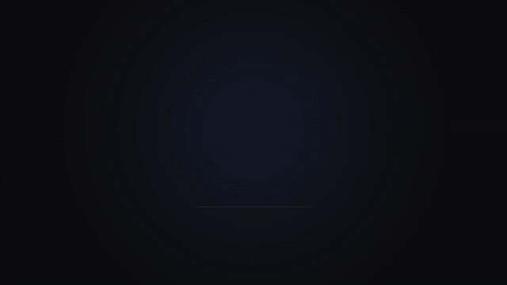
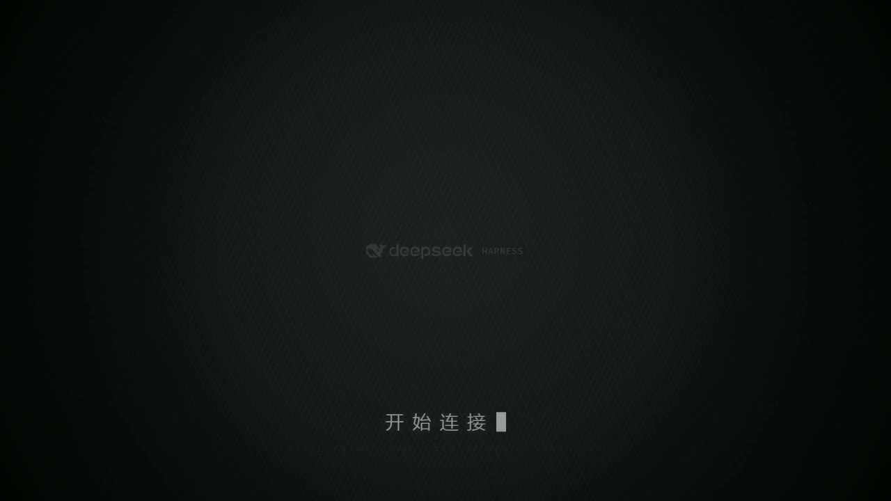
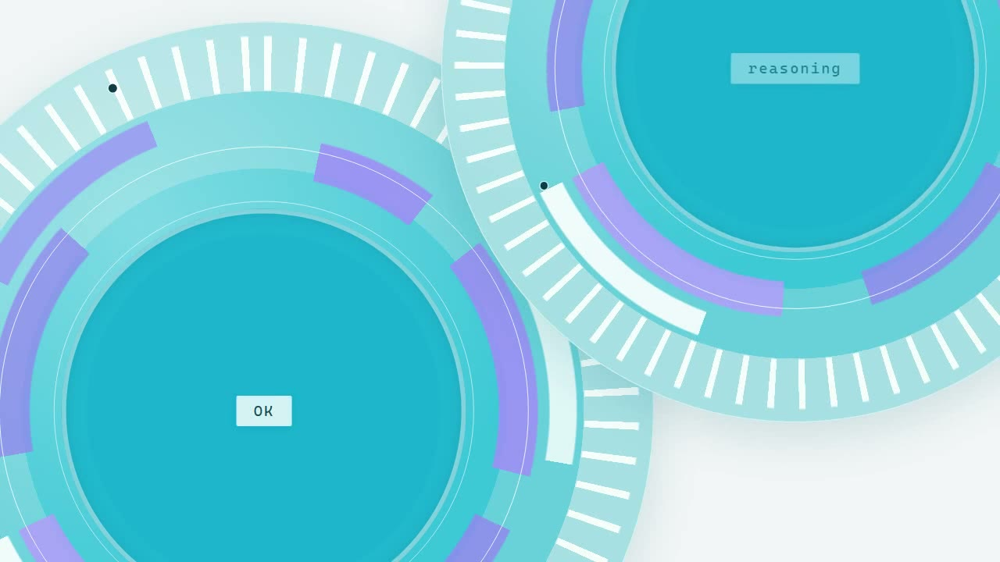
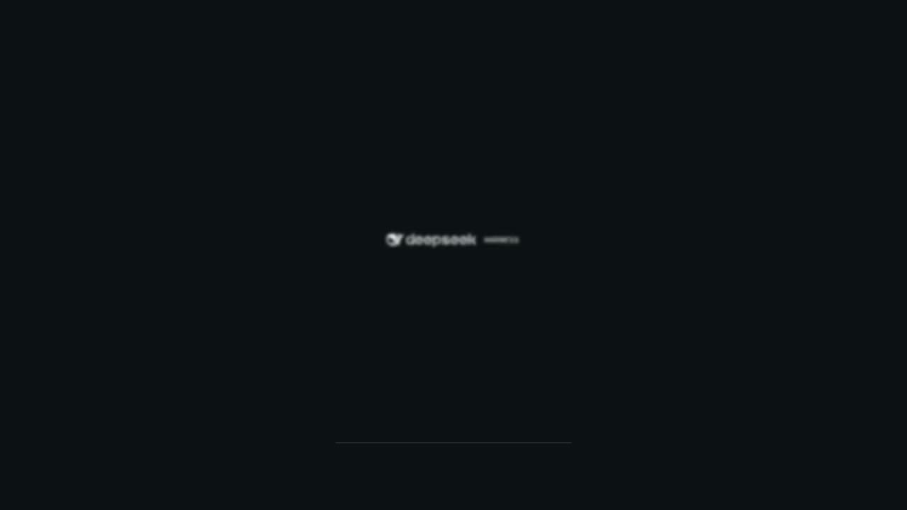
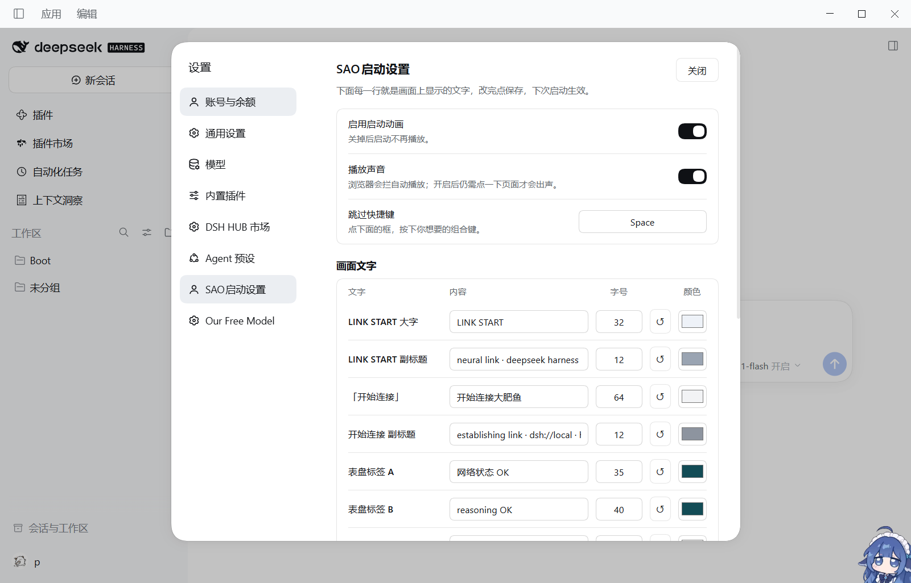

# dsh-sao-animation

**DeepSeek Harness 启动动画插件（刀剑神域 / SAO 风格）** —— 启动时播放刀剑神域连接时动画开场，
放完自动淡出，不挡你进工作台。

> `LINK START` 倒计时环 → 开始连接 → 闪白 → 彩屑爆裂 → 满屏颜料笔触 → 双环 HUD → `Language` / `DeepSeek` → `Log in_::` → 官方字标收束



上面这段就是完整的 13.6s（GIF 640×360 / 15fps / 约 3.9 MB）。想要画质更好的成片：
[`dist/dsh-sao-animation.mp4`](dist/dsh-sao-animation.mp4)（1280×720 / 30fps / H.264 + AAC）。

| 开始连接 | 满屏颜料笔触 | 双环 HUD | 字标收束 |
| --- | --- | --- | --- |
|  |  |  |  |

文案、字号、颜色、音频、跳过快捷键都在 **设置 → SAO启动设置** 里改，改完即时预览。



> 社区作品，**与 DeepSeek 官方无隶属关系**。随动画一起发布的音轨与 30 帧笔触抽帧来自一支
> 第三方影片，不在本项目的 MIT 授权范围内，详见 [THIRD_PARTY_NOTICES.md](THIRD_PARTY_NOTICES.md)。

---

## 安装

### 桌面端（官方 Desktop App）

1. 打开 DSH → **插件 / Plugins** → 添加插件
2. 安装源填 `github:YaJing0412/dsh-sao-animation`
   （已经 clone 到本地就填仓库的**绝对路径**）
3. 装好后**完全退出并重启 DSH**（客户端模块图与桌面注入表只在启动时收集一次）

> Desktop 的 `desktop` profile 由官方客户端托管，不建议用下面的 `dsh` CLI 直接改它。

### Web（`dsh web` / web profile）

```powershell
dsh plugin --profile web add github:YaJing0412/dsh-sao-animation
```

装完重启 `dsh web`；浏览器还加载着旧 bundle 的话按 `Ctrl+Shift+R`。

`dsh` 不在 PATH 上时，用完整路径调用 CLI：

```powershell
node "$env:LOCALAPPDATA\Programs\DeepSeek Harness\resources\app\dsh\node_modules\@deepseek-ai\dsh\lib\bin.js" `
  plugin --profile web add github:YaJing0412/dsh-sao-animation
```

### 本地源码（改代码用）

```powershell
git clone https://github.com/YaJing0412/dsh-sao-animation
dsh plugin --profile web add "C:\path\to\dsh-sao-animation"     # 本地路径 = link 安装
```

- 改 **`lib/*.js`**（插件逻辑）→ 重装插件或重启客户端生效
- 改 **`animation/`**（动画源码）→ 跑 `python tools/build.py` 重新生成
  `assets/animation.html`，刷新页面即可 —— 插件读的就是这个文件

CLI、插件面板都不好使时，可以手工改 profile 配置，步骤见
[INSTALL.md §1.3](INSTALL.md#13-手动安装兜底)。

### 卸载

```powershell
dsh plugin --profile web remove dsh-sao-animation
```

桌面端在插件面板里卸载。用户配置留在 `~/.dsh/dsh-sao-animation.json`，不需要就直接删。

---

## 设置

**设置 → SAO启动设置**（侧栏最后一个分区）：

| 项 | 说明 |
| --- | --- |
| 启用启动动画 | 关掉后启动不播，设置页仍可改 |
| 播放声音 | 默认开；浏览器拦自动播放时先静音跑，点一下页面才有声 |
| 跳过快捷键 | 点输入框后按任意组合键即可（默认 `Escape`，支持 `Ctrl+Shift+B`、`F8`、`Space` …） |
| 画面文字（15 项） | 每项三件套：**文字 / 字号（px，基准 1280 宽，播放时等比缩放）/ 颜色**；字号可直接输入 6–200 的任意数字 |
| ↺ | 只把这一行回退到设计默认 |
| 保存 / 恢复默认 / 预览动画 | 预览在**当前窗口内嵌**播放草稿，`Esc` 或播完自动收起 |

15 行文字对应：`LINK START` 大字与副标题、「开始连接」与副标题、四枚 chip
（`OK` / `reasoning` / `context` / `tools`）、胶囊左右、登录卡标题与两个字段、收尾标语、跳过按钮文字。

配置写在 `$DSH_HOME/dsh-sao-animation.json`（默认 `~/.dsh/dsh-sao-animation.json`），
缺失时用内置默认值；旧文件名 `dsh-boot-animation.json` 仍会被读取，点一次保存即完成迁移。

### 插件说明显示在哪

宿主读取插件显示元数据的规则是「**先看 `locale/*.json` 的 `meta.title` / `meta.description`，
缺什么用 `package.json` 的 `name` / `description` 兜底**」，图标优先 `package.json` 的 `icon` 字段。
本插件因此提供 `locale/zh.json`、`locale/en.json` 与 `icon.svg`，插件列表里显示的就是它们
（设置页里不再重复放说明）。

### 调试开关

宿主会清洗查询串，所以开关走 hash：

- `#noboot` —— 本次不播
- `#boot` —— 强制重播

单独看动画：`http://127.0.0.1:<port>/dsh-boot/animation.html`
（`?t=5900&pause=1` 定格在 5.9s，`?hud=1` 显示时间码）。
`/dsh-boot/...` 是插件最早用的内部路由名，改名后**故意保持不变**，免得老书签与已装实例失效。

---

## 分镜与时间轴

动画不是自己走一套时间：**动画时间 t 对应源片 13.4s + t**，每个画面对准原片同一位置的声音，
总长 13.6s = 408 帧 @ 30fps。

| 时间 | 画面 |
| --- | --- |
| 0.0–2.0s | 暗场环形 HUD，倒计时 `00:03 → 00:00`，`LINK START` 字距收拢，底部进度线走满 |
| 2.0–3.5s | 字标微光浮现，**「开 始 连 接」**＋光标闪，`establishing link · dsh://local` |
| 3.48s | 闪白 |
| 3.6–4.9s | 中心彩色碎片爆裂＋模糊品红水滴飞向右上 |
| 4.9–5.45s | 白场过渡 |
| **5.45–6.45s** | **满屏彩色颜料笔触**（源片原画，30 帧 WebP） |
| 6.4–6.75s | 白闪过曝收束 |
| 6.85–9.75s | 双圆环 HUD 滑入 / 平移 / 退场 → 右缘五枚小环带横杠落位 |
| 9.64–10.75s | 蓝色胶囊 `Language` → 滑出「▶ DeepSeek」 |
| 10.75–11.7s | 青色卡片 `Log in_::` ＋ `:account` / `:api key`（掩码逐颗打字） |
| 11.7–13.6s | 暗场收束，官方字标中央擦除展开 → `EVERYTHING IS A PLUGIN` → 蓝青进度条走满 |

笔触段原本排在 4.4s，比它自己那段音乐早了约 1.05s —— 这就是"听起来不同步"的根源，
现在笔触帧与音轨上那一击同时发生。完整分镜说明见 [docs/STORYBOARD.md](docs/STORYBOARD.md)。

---

## 仓库结构

```
dsh-sao-animation/             ← 仓库根就是 DSH 插件包（pnpm/npm 直接可装）
├── package.json               name / exports / dsh.bundle.patch / dsh.client / icon
├── cordis.patch.yml           bundle patch：把插件作为一层插进 profile 的 loader 树
├── icon.svg                   插件图标
├── locale/
│   ├── zh.json                插件列表显示的中文标题与简介
│   └── en.json                同上（英文）
├── lib/
│   ├── index.js               宿主半区：/dsh-boot/animation.html、/dsh-boot/config（读写配置）
│   ├── client.js              客户端模块：启动遮罩（shell.overlay）+ 设置页（settings.section）
│   └── client-dom.js          纯 DOM 实现：桌面壳没有客户端模块图，靠它兜底
├── assets/
│   └── animation.html         动画本体（单文件，2.2 MB，音轨/笔触/字标全内联）
├── animation/                 动画源码：boot.html · boot.css · boot.js · boot-audio.mp3 · blades.json · brand.svg
├── tools/                     构建与出片工具链（Python，路径可移植）
├── docs/                      PLUGIN.md · STORYBOARD.md · preview/（GIF + 4 张静帧）
└── dist/dsh-sao-animation.mp4 1280×720 成片（可独立使用）
```

`assets/animation.html` 是**构建产物**：既是插件运行时 `/dsh-boot/animation.html` 的内容，
也是一个可以**双击直接播放**的单文件成品。改动画请改 `animation/` 再构建，别手改 `assets/`。

为什么有两份客户端实现（`client.js` 与 `client-dom.js`）、它们怎么去重、路由表和配置校验
长什么样，见 [docs/PLUGIN.md](docs/PLUGIN.md)。

---

## 动画本体（可以完全脱离 DSH 用）

| 想要什么 | 用什么 |
| --- | --- |
| 在浏览器里放一遍 | 双击 `assets/animation.html` |
| 一段能剪进视频的片子 | `dist/dsh-sao-animation.mp4`（1280×720 / 30fps / 13.6s / H.264 + AAC） |
| 嵌进自己的页面 | `iframe` 加载它，`?once=1` 播完会向父页面 `postMessage('dsh-boot-done')` |

| 操作 | 说明 |
| --- | --- |
| `空格` / 点击画面 | 重播（并重开音轨） |
| `←` `→` | 后退 / 前进 0.5s |
| `1`–`9` | 跳到第 N 段场景 |

| 参数 | 说明 |
| --- | --- |
| `?t=5900&pause=1` | 定格在 5.9s（逐帧截图就靠它） |
| `?hud=1` | 显示时间码 / 段名 / 分辨率 |
| `?once=1` | 只播一次，播完淡出并 `postMessage('dsh-boot-done')` |
| `?mute=1` 或 `?audio=0` | 强制静音 |
| `?cfg=<URL 编码的 base64 JSON>` | 覆盖文案与字号/颜色 |

### 自定义文案与字号（`?cfg=`）

```jsonc
{
  "texts":  { "connect": "正在接入", "tagline": "Everything is a Plugin" },
  "styles": { "connect": { "size": 64, "color": "#ff0000" } }
}
```

可用键：`linkBig` `linkMono` `connect` `connectMono` `chipA` `chipB` `chipC` `chipD`
`pillLeft` `pillRight` `loginTitle` `fieldA` `fieldB` `tagline`。

生成地址时**整段 base64 都要 URL 编码**，否则其中的 `+` 会被解析成空格、载荷被破坏
（插件内部的 `lib/client*.js` 已经替你做了这一步；动画侧也会把读回来的空格还原成 `+` 兜底）：

```bash
python -c "import base64,json,urllib.parse;print(urllib.parse.quote(base64.b64encode(json.dumps({'texts':{'connect':'正在接入'}},ensure_ascii=False).encode()).decode()))"
```

### 重新生成

```bash
pip install opencv-python numpy         # 只有出片、抽帧才需要
python tools/build.py                   # animation/* -> assets/animation.html（插件直接生效）
python tools/serve.py                   # 起个本地 http，源码版也能加载 blades.json
python tools/capture.py                 # 无头 Chrome 截 408 帧（约 70s）
python tools/refill.py                  # 有丢帧就反复跑，直到 0 missing
python tools/encode.py                  # 裁黑边 -> dist/*-silent.mp4
python tools/mux_audio.py               # 混音 -> dist/dsh-sao-animation.mp4
```

Chrome / ffmpeg 自动探测，也可用 `CHROME` / `FFMPEG` 环境变量指定；
帧目录默认 `%TEMP%\dsh-boot-frames`，可用 `DSH_FRAMES` 改。

### 换成你自己的素材

```bash
python tools/extract_blades.py --clip my.mp4 --ss 18.85 --t 1.0   # 重建笔触段（含去角标）
python tools/mux_audio.py --clip my.mp4 --ss 13.4 --t 13.6        # 换成你的音轨
# 再把 animation/brand.svg 换成你自己的字标
```

完整步骤见 [INSTALL.md §6](INSTALL.md#6-用你自己的素材重做避免第三方版权)。

---

## 依赖

**插件运行时零依赖**：只有纯 ESM 的 `lib/*.js` + 一个静态 HTML，没有 native 模块、没有安装期构建脚本
（所以 `github:` 安装不会被 pnpm 的 `allowBuilds` 拦下）。

只有**重新生成动画**时才需要：

| 依赖 | 版本 | 用途 | 许可证 |
| --- | --- | --- | --- |
| Python | 3.9+ | 跑 `tools/` 里的脚本 | PSF-2.0 |
| OpenCV（`opencv-python`） | 4.x | 抽帧、去角标、编码 WebP、写 MP4 | Apache-2.0 |
| NumPy | 1.24+ | OpenCV 的数组后端 | BSD-3-Clause |
| Chrome / Chromium / Edge | 任意近版 | `capture.py` 逐帧截图 | 专有（仅调用） |
| ffmpeg | 4.0+ | 抽帧、混音、H.264 重编码 | LGPL-2.1+ / GPL-2.0+ |

完整清单与第三方素材声明见 [THIRD_PARTY_NOTICES.md](THIRD_PARTY_NOTICES.md)。

## 兼容性

- 在 `@deepseek-ai/dsh-*` **0.2.0-rc.x** 插件族上实测（desktop profile + web profile，桌面端日常在用）。
- 插件只用宿主公开面：`webserver` 路由注册、`webserver/index-inject` 注入、客户端 `shell.overlay`
  与 `settings.section` 槽位。宿主升级后若接口变动，可能需要跟一手
  （DSH 会提示 `dsh plugin allow-version`，正常情况下不需要）。

## 许可证

代码与文档以 **MIT** 授权，见 [LICENSE](LICENSE)。
`animation/boot-audio.mp3`、`animation/blades.json`、`assets/animation.html` 内联的音轨、
`dist/dsh-sao-animation.mp4`、`docs/preview/boot-preview.gif` 以及 `docs/preview/02-blades.jpg`
**不含**在 MIT 授权内，详见 [THIRD_PARTY_NOTICES.md](THIRD_PARTY_NOTICES.md)。

---

## English

**dsh-sao-animation** is a Sword-Art-Online-flavoured startup-animation plugin for
**DeepSeek Harness**: a 13.6 s splash (`LINK START` → establishing link → paint blast →
twin-ring HUD → login card → brand lockup) that fades out by itself. Every caption, its font
size and colour, the soundtrack and the skip hotkey are editable in
**Settings → SAO启动设置**.

Install it from the desktop app's **Plugins** panel with
`github:YaJing0412/dsh-sao-animation`, or from the CLI:

```powershell
dsh plugin --profile web add github:YaJing0412/dsh-sao-animation
```

The plugin half (`lib/`) is dependency-free ESM with no install-time build step — the single-file
animation it serves is committed at `assets/animation.html`, which you can also just double-click
to play on its own. `docs/preview/boot-preview.gif` shows the whole thing; a 1280×720 H.264 cut
lives at `dist/dsh-sao-animation.mp4`. Rebuilding from `animation/` needs Python 3.9+,
`opencv-python`, a Chromium-based browser and ffmpeg (`python tools/build.py`, then
`capture.py` / `encode.py` / `mux_audio.py` for the MP4).

Code and docs are MIT. The bundled soundtrack, the 30 lifted frames and the brand mark are
third-party material and are **not** covered by that licence — read
[THIRD_PARTY_NOTICES.md](THIRD_PARTY_NOTICES.md) before redistributing or using this
commercially. This is a community project, not affiliated with DeepSeek.
